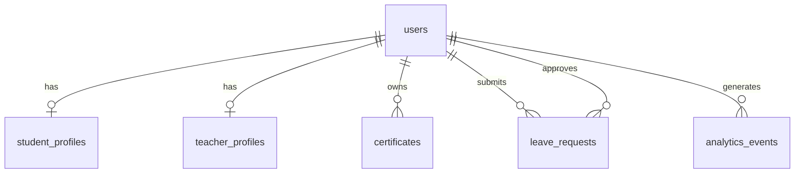
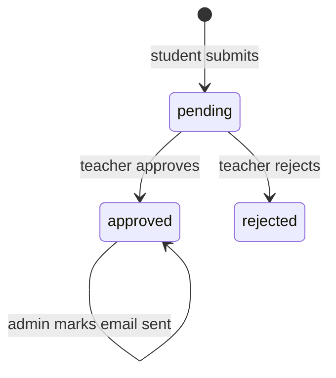

# Software Requirements Specification for Certificates HQ (CerTrack)

Version 1.0 draft
Prepared by: CerTrack project team
Date created: October 14, 2026

Format follows the Wiegers SRS template.

## Revision History

| Name | Date | Reason For Changes | Version |
|---|---|---|---|
| CerTrack project team | 2026-10-14 | Initial draft derived from the current codebase | 1.0 |

---

## 1. Introduction

### 1.1 Purpose
This SRS specifies the requirements for Certificates HQ (CerTrack) release 1.0. It covers the whole system: the static web frontend, the Node.js/Express REST API, and the PostgreSQL database.

### 1.2 Document Conventions
- Requirements are tagged `REQ-<AREA>-<n>` (AUTH, STU, TCH, ADM, NFR).
- "Shall" marks a mandatory requirement. Each feature has one priority (High, Medium, Low) that its requirements inherit.
- Status notes marked **[Current]** describe known behavior of the existing implementation where it differs from the target requirement.

### 1.3 Intended Audience and Reading Suggestions
- Developers and testers: read sections 2, 3, 4, then 5.
- Project supervisors and reviewers: read sections 1, 2, and 4.
- Deployers: read sections 2.4, 3.3, 3.4, then the repository's `DEPLOYMENT.md`.

### 1.4 Product Scope
CerTrack lets students record their certificates and submit leave/event requests (for example for hackathons or competitions) with proof. Teachers review and approve or reject those requests. Administrators manage institutes, view all requests, trigger notifications for approved requests, and see usage analytics. The goal is to replace paper and chat-based leave approvals and scattered certificate records with one searchable system per institute.

### 1.5 References
- Repository documents: `readme.md`, `DEPLOYMENT.md`, `TODO.md`
- Database schema: `backend/schema.sql`
- API entrypoint: `backend/src/server.js`
- Karl E. Wiegers, Software Requirements Specification template, 1999

---

## 2. Overall Description

### 2.1 Product Perspective
CerTrack is a new, self-contained web application with three tiers.

```
Browser (static HTML/CSS/JS)  <-- HTTP/JSON + JWT -->  Express API  <-- SQL -->  PostgreSQL
        frontend/                                       backend/src              backend/schema.sql
```

The frontend also has a demo mode: if the API is unreachable, it falls back to browser localStorage with built-in demo users.

### 2.2 Product Functions
- Account signup, login, and password-reset request
- Student: profile, certificate management, leave/event requests, course and contest browsing, resume builder
- Teacher: profile, review pending requests, approve/reject, approved/rejected history, student list
- Admin: dashboard statistics, all-requests view, email-notification marking, institute management, user listing, analytics charts
- Role-based access control for all of the above

### 2.3 User Classes and Characteristics
| Class | Description | Priority |
|---|---|---|
| Student | Frequent user; adds certificates and submits requests; basic technical skill | High |
| Teacher | Periodic user; reviews requests; includes an HOD variant that can override teacher decisions in demo mode | High |
| Admin | Occasional user; oversees institutes and reports; includes a principal variant in demo mode | Medium |

### 2.4 Operating Environment
- Server: Node.js (tested on v24) with Express 4, PostgreSQL 18 (schema uses `uuid-ossp`), Windows or Linux
- Client: current desktop and mobile browsers with JavaScript enabled
- Admin analytics loads Chart.js from the jsDelivr CDN

### 2.5 Design and Implementation Constraints
- Frontend must remain framework-free HTML, CSS and vanilla JavaScript.
- Backend must use Node.js, Express, `pg`, `bcryptjs` and `jsonwebtoken`.
- All primary keys are UUIDs.
- Configuration comes from environment variables (`DATABASE_URL`, `JWT_SECRET`, `JWT_EXPIRES_IN`, `FRONTEND_URL`, `PORT`).

### 2.6 User Documentation
`readme.md` (overview and local run steps) and `DEPLOYMENT.md` (deployment and API reference). No in-app help is delivered in 1.0.

### 2.7 Assumptions and Dependencies
- A PostgreSQL instance is reachable and `backend/schema.sql` has been applied.
- Users have an email address; no email delivery service is integrated in 1.0.
- The frontend is served over HTTP(S) from a location allowed by the API's CORS setting.
- Chart.js CDN availability for admin charts.

---

## 3. External Interface Requirements

### 3.1 User Interfaces
- Authentication pages: `login.html`, `signup.html`, `forgot.html` (styled by `style2.css`).
- Portals: `student-portal.html`, `teacher-portal.html`, `admin-portal.html` (styled by `style-portal.css`), each using tab navigation.
- Error and success feedback is shown through browser alerts in 1.0.
- `qr.html` shows a support QR code.

### 3.2 Hardware Interfaces
None.

### 3.3 Software Interfaces
| Component | Use |
|---|---|
| PostgreSQL 18 | Persistent storage via the `pg` driver |
| Express 4 | REST API under `/api` |
| bcryptjs | Password hashing (cost factor 12) |
| jsonwebtoken | Signed access tokens |
| Chart.js (CDN) | Admin analytics charts |

### 3.4 Communications Interfaces
- HTTP/JSON REST API on port 3001 (default). Protected routes require `Authorization: Bearer <token>`.
- Endpoints: `/api/auth/*`, `/api/student/*`, `/api/teacher/*`, `/api/admin/*`, `/api/health`.
- Production deployments shall use HTTPS and restrict CORS to the frontend origin.

---

## 4. System Features

### 4.1 Authentication and Account Management
**4.1.1 Description and Priority:** High. Users create accounts and sign in with a role.

**4.1.2 Stimulus/Response**
- User submits signup form: system creates the account and redirects to login.
- User submits login with email, password, and role: system returns a token and redirects to the matching portal.
- User submits forgot-password form: system shows a neutral confirmation.

**4.1.3 Functional Requirements**
- REQ-AUTH-1: The system shall create a user from name, email, password and role (student, teacher, or admin).
- REQ-AUTH-2: The system shall reject signup with missing fields, an invalid role, or an already registered email (HTTP 400/409).
- REQ-AUTH-3: The system shall store passwords only as bcrypt hashes.
- REQ-AUTH-4: The system shall authenticate by email and password and reject a role that does not match the account (HTTP 401).
- REQ-AUTH-5: The system shall issue a JWT containing user id, email, role and name, with configurable expiry (default 7 days).
- REQ-AUTH-6: The system shall create an empty student or teacher profile row on signup for those roles.
- REQ-AUTH-7: The forgot-password endpoint shall respond identically whether or not the email exists. **[Current]** No reset email is sent.
- REQ-AUTH-8: Portal pages shall redirect to login when no valid session exists or the session role does not match the page.
- REQ-AUTH-9: The system shall record signup and login events for analytics.

### 4.2 Student Profile
**4.2.1 Description and Priority:** Medium. Students maintain personal, academic, link and address details.

**4.2.2 Stimulus/Response:** Student opens the profile tab: fields are populated. Student saves: values are stored and a confirmation is shown.

**4.2.3 Functional Requirements**
- REQ-STU-1: The system shall return and update the student's profile (name, institute, roll number, degree, branch, college, graduation year, CGPA, phone, LinkedIn, GitHub, skills, bio, date of birth, gender, address, city, state).
- REQ-STU-2: Only the authenticated student shall read or modify their own profile.

### 4.3 Certificate Management
**4.3.1 Description and Priority:** High.

**4.3.2 Stimulus/Response:** Student adds a certificate: it appears in the list. Student deletes one: it is removed.

**4.3.3 Functional Requirements**
- REQ-STU-3: The system shall let a student list, add, and delete their own certificates (name required; organization, link, issue date, expiry date and credential id optional).
- REQ-STU-4: The system shall prevent a student from deleting another user's certificate.
- REQ-STU-5: The system shall record a certificate-added analytics event.
- REQ-STU-6: **[Current]** The student portal stores certificates in localStorage only and does not call the certificate API. The system shall be changed to use the API when available (see Appendix C).

### 4.4 Leave/Event Requests (Student)
**4.4.1 Description and Priority:** High.

**4.4.2 Stimulus/Response:** Student submits the request form with event details and proof: request is created as pending. Student views the list: statuses and decision dates are shown.

**4.4.3 Functional Requirements**
- REQ-STU-7: The system shall let a student create a request with event name, type, date range, proof file name and notes; event name and both dates are required (HTTP 400 otherwise).
- REQ-STU-8: New requests shall have status `pending`.
- REQ-STU-9: The system shall let a student list only their own requests with status and approver name.
- REQ-STU-10: **[Current]** The student portal stores requests in localStorage only. Teacher-side API review therefore does not see them. See Appendix C.

### 4.5 Courses, Contests, and Resume Builder
**4.5.1 Description and Priority:** Low.

**4.5.3 Functional Requirements**
- REQ-STU-11: The student portal shall list courses and contests filterable by topic or type.
- REQ-STU-12: The student portal shall generate a text resume preview from entered details, and suggest certificates and courses for a job role.

### 4.6 Teacher Review
**4.6.1 Description and Priority:** High.

**4.6.2 Stimulus/Response:** Teacher opens Pending: cards show student, event, dates, proof and notes. Teacher clicks Approve or Reject: the request moves to the matching history tab.

**4.6.3 Functional Requirements**
- REQ-TCH-1: The system shall list pending, approved, and rejected requests for teachers.
- REQ-TCH-2: The system shall let a teacher approve or reject a pending request, recording the teacher and timestamp.
- REQ-TCH-3: The system shall refuse to action a request that is not pending (HTTP 404).
- REQ-TCH-4: The system shall record request-approved and request-rejected analytics events.
- REQ-TCH-5: The system shall list students with roll number, degree, branch, certificate count and request count.
- REQ-TCH-6: The system shall let a teacher view and update their profile (name, institute, phone, department, designation, employee id).
- REQ-TCH-7: **[Current]** The API applies a single global decision per request. Per-teacher routing and HOD override exist only in the localStorage demo mode.

### 4.7 Admin Dashboard and Requests
**4.7.1 Description and Priority:** Medium.

**4.7.3 Functional Requirements**
- REQ-ADM-1: The system shall show counts of institutes, students, teachers, requests today, total requests, and pending requests.
- REQ-ADM-2: The system shall list all requests, filterable by status, with pagination (page size capped at 100).
- REQ-ADM-3: The system shall let an admin mark an approved request as notified by email (sets mail-sent flag and time). **[Current]** No email is actually sent.

### 4.8 Institutes and Users
**4.8.1 Description and Priority:** Medium.

**4.8.3 Functional Requirements**
- REQ-ADM-4: The system shall let an admin list, add, and delete institutes.
- REQ-ADM-5: The system shall let an admin list users by role.

### 4.9 Analytics
**4.9.1 Description and Priority:** Medium.

**4.9.3 Functional Requirements**
- REQ-ADM-6: The system shall provide analytics from stored events: signups per day, logins per day, requests per day, approval breakdown, certificates per day, monthly growth, and top institutes by students.
- REQ-ADM-7: The admin portal shall show active users (7 days), approval rate, and approved/rejected/pending counts.

### 4.10 Demo (Offline) Mode
**4.10.1 Description and Priority:** Low.

**4.10.3 Functional Requirements**
- REQ-DEMO-1: When the API is unreachable, the frontend shall fall back to built-in demo users and localStorage data and tell the user it is in demo mode.

---

## 5. Other Nonfunctional Requirements

### 5.1 Performance Requirements
- NFR-PERF-1: Typical API responses shall complete within 500 ms at the 95th percentile with up to 100 concurrent users on a single server.
- NFR-PERF-2: List endpoints shall not return unbounded results beyond what is specified (admin requests capped at 100 per page).
- NFR-PERF-3: The database connection pool shall be limited to 20 connections.

### 5.2 Safety Requirements
No physical safety concerns. Deletion of certificates and institutes is permanent; the UI should confirm before deleting (TBD, see Appendix C).

### 5.3 Security Requirements
- NFR-SEC-1: Passwords shall be hashed with bcrypt; plaintext passwords shall never be stored or logged.
- NFR-SEC-2: All non-auth API routes shall require a valid JWT, and each route shall enforce the allowed role.
- NFR-SEC-3: All SQL shall use parameterized queries; user-supplied numeric values interpolated into SQL shall be parsed and bounded.
- NFR-SEC-4: `JWT_SECRET` and database credentials shall come from environment variables and not be committed (`backend/.env` is git-ignored).
- NFR-SEC-5: Production shall use HTTPS, restrict CORS to the frontend origin, and force TLS for the database connection.
- NFR-SEC-6: Seeded demo passwords shall be changed before production use.
- NFR-SEC-7: User-provided text rendered by the frontend shall be escaped to prevent script injection. **[Current]** Several frontend views build HTML from raw values; this is a known gap (Appendix C).
- NFR-SEC-8: The system should rate-limit login attempts (TBD).

### 5.4 Software Quality Attributes
- Usability: a first-time student shall be able to add a certificate within 2 minutes without help.
- Reliability: API errors shall return JSON with an `error` field and an appropriate status code; server errors shall not expose stack traces to clients.
- Maintainability: backend code is organized by route module; frontend scripts are one per page.
- Portability: runs on any OS supported by Node.js and PostgreSQL.
- Testability: `/api/health` supports basic liveness checks. Automated tests are not yet present (TBD).

### 5.5 Business Rules
- BR-1: Students can only access and change their own data.
- BR-2: Only teachers can approve or reject requests; only pending requests can be actioned.
- BR-3: Only admins can manage institutes and view system-wide analytics.
- BR-4: Only approved requests can be marked as email-notified.
- BR-5: Each email address can register once.

---

## 6. Other Requirements

### 6.1 Database Requirements
Tables: `users`, `student_profiles`, `teacher_profiles`, `institutes`, `certificates`, `leave_requests`, `analytics_events`. Profile and certificate rows are removed when their user is deleted (cascade). Schema creation is idempotent (`CREATE TABLE IF NOT EXISTS`).

### 6.2 Deployment
Frontend can be served statically (Nginx, Netlify, Vercel); backend runs under Node (PM2 recommended). The frontend API base URL is configurable through `window.CHQ_API_BASE`.

---

## Appendix A: Glossary
| Term | Meaning |
|---|---|
| SRS | Software Requirements Specification |
| JWT | JSON Web Token used for API authentication |
| HOD | Head of Department; a teacher who can override teacher decisions in demo mode |
| Leave/event request | A student's request for permission to attend an event such as a hackathon or competition, with proof |
| Demo mode | Frontend behavior using localStorage when the API is unreachable |
| CORS | Cross-Origin Resource Sharing |

## Appendix B: Analysis Models

### B.1 Entity Relationships


### B.2 Request State Transitions


## Appendix C: To Be Determined List
1. Connect the student portal to the certificate and request APIs so data is shared with teachers and admins (REQ-STU-6, REQ-STU-10).
2. Implement per-teacher routing and HOD override on the server (REQ-TCH-7).
3. Integrate real email delivery for password reset and approval notifications (REQ-AUTH-7, REQ-ADM-3).
4. Escape user-provided text in frontend rendering (NFR-SEC-7).
5. Add login rate limiting (NFR-SEC-8).
6. Add delete confirmations in the UI (section 5.2).
7. Add automated tests (section 5.4).
8. Decide how proof files are uploaded and stored; only the file name is saved today.
9. Replace the placeholder GitHub link and correct the support email typo in the student portal footer.
